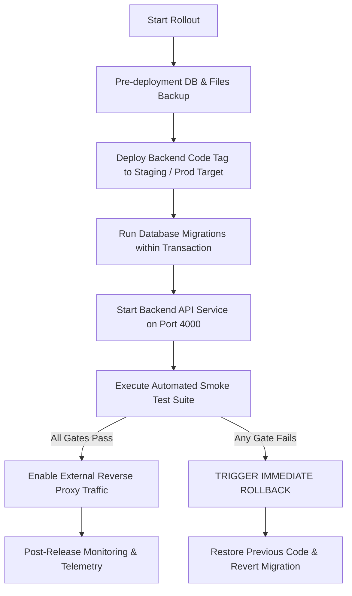

# Production Deployment & Rollback Runbook

> **Target Engagement:** Sloane ⇄ Trinova Integration & Document-Signing Workflow  
> **Authority:** [`context/06_testing_deployment_context.md`](file:///d:/V2/Sloane_Trinova_Integration/context/06_testing_deployment_context.md) §10–12  
> **Mandatory Rule:** If release criteria fail: **STOP / ROLLBACK**. Do not continue deployment merely because part of the system works.

---

## 1. Pre-Deployment Readiness Checklist

Before executing production deployment, verify each of the following release conditions:

| Check | Requirement | Verification Method |
|---|---|---|
| **1. Staging Approval Gate** | Staging acceptance report signed off by Hamza Malik and Kirsty Allen. | Confirm [`context/staging-acceptance-report.md`](file:///d:/V2/Sloane_Trinova_Integration/context/staging-acceptance-report.md) approved. |
| **2. Production Backup** | Full database backup taken and restore verified. | Run `mysqldump` / snapshot drill; verify restore on standby instance. |
| **3. Independent Secrets** | Production credentials configured independently from staging. | Verify server `.env` contains dedicated high-entropy keys (`SLOANE_API_KEY`, etc.). |
| **4. Database Isolation** | **Never copy staging database over production.** | Confirm production migration runner applies only schema migration scripts. |
| **5. Storage Directories** | Document storage directory provisioned with proper write permissions. | Verify directory `/var/data/trinova/documents` exists with `chmod 750`. |
| **6. Email Delivery** | Production transactional SMTP configured with verified domain DKIM/SPF. | Verify `MAIL_SANDBOX_MODE=false` and SMTP credentials. |
| **7. Signing Engine** | Self-hosted Documenso instance running with HTTPS webhook callback configured. | Ping Documenso health endpoint and verify HMAC webhook secret match. |

---

## 2. Release Execution Procedure

Execute rollout in the following controlled sequence:



### Step 2.1: Pre-Deployment Backup
```bash
# 1. Database snapshot
mysqldump -u trinova_app -p --single-transaction --quick --lock-tables=false trinova_prod > /backup/trinova_prod_predeploy_$(date +%Y%m%d_%H%M%S).sql

# 2. File storage backup
tar -czf /backup/trinova_documents_$(date +%Y%m%d_%H%M%S).tar.gz /var/data/trinova/documents
```

### Step 2.2: Code Deployment & Migration Execution
```bash
# Pull production release tag
cd /var/www/trinova-api
git fetch --tags
git checkout tags/v1.0.0-release

# Install runtime dependencies (zero build step, pure ES modules)
npm ci --production

# Run schema migrations in transactional mode
npm run migrate:up
```

### Step 2.3: Start Service & Execute Controlled Smoke Test
```bash
# Restart background service via PM2 / systemd
systemctl restart trinova-api-server

# Run controlled smoke test suite against designated test record
npm run test:smoke
```

---

## 3. Smoke Test Decision Gates

Run the automated smoke test script:
```bash
node --test tests/smoke.test.js
```

The smoke test verifies 7 mandatory release gates:
1. **Gate 1: Public Health Check** (`GET /api/v1/health` returns 200 OK)
2. **Gate 2: Scoped Authentication** (Rejects invalid credentials, admits valid bearer tokens)
3. **Gate 3: Read Contract Integrity** (Returns company 360 hierarchy, multi-director arrays, services)
4. **Gate 4: Write & Idempotency** (Enforces `Idempotency-Key` and prevents duplicate records)
5. **Gate 5: Privacy Boundary Protection** (Rejects unconfirmed notes from Sloane with 422)
6. **Gate 6: Signing Lifecycle Creation** (Creates Documenso request with separate file flags)
7. **Gate 7: Audit Trail Integrity** (Records deployment operations without credential leakage)

> **HARD STOP RULE:** If **ANY** gate fails, stop rollout immediately. Do not attempt in-place production debugging. **Proceed directly to Section 4 (Rollback Procedure).**

---

## 4. Rollback Procedure

Per [`context/06_testing_deployment_context.md`](file:///d:/V2/Sloane_Trinova_Integration/context/06_testing_deployment_context.md) §12:  
*Preserve any new production records and signed documents already created during the deployment window.*

### Step 4.1: Divert Traffic / Maintenance Mode
```bash
# Set nginx/reverse proxy to maintenance page
ln -sf /etc/nginx/conf.d/maintenance.conf /etc/nginx/sites-enabled/trinova.conf
nginx -s reload
```

### Step 4.2: Stop API Service
```bash
systemctl stop trinova-api-server
```

### Step 4.3: Preserve Deployment Window Artifacts
```bash
# Check if any new signed documents or client notes were recorded during the deployment window
mkdir -p /backup/incident_preservation
cp -r /var/data/trinova/documents/* /backup/incident_preservation/
```

### Step 4.4: Revert Code to Previous Stable Release Tag
```bash
cd /var/www/trinova-api
git checkout tags/v0.9.8-stable
```

### Step 4.5: Revert Database Migrations
```bash
# Revert schema migrations using migration-down scripts
npm run migrate:down

# If migration-down fails, restore the pre-deployment database backup
# mysql -u trinova_app -p trinova_prod < /backup/trinova_prod_predeploy_<timestamp>.sql
```

### Step 4.6: Restart Previous Service & Verify Portal Stability
```bash
systemctl start trinova-api-server

# Run regression test suite on previous stable version
npm test

# Re-enable normal proxy traffic
ln -sf /etc/nginx/conf.d/trinova_api.conf /etc/nginx/sites-enabled/trinova.conf
nginx -s reload
```

---

## 5. Post-Deployment Monitoring & Telemetry

Monitor the following key metrics for 72 hours post-release:
- **API Error Rate:** Must remain `< 0.1%`. Alert if 5xx errors exceed 5 per 15-minute window.
- **Signing Webhook Delivery Failures:** Monitor `/api/v1/signing/webhooks` failure count.
- **Idempotency Replay Hits:** Measure duplicate write suppression rate.
- **Companies House Rate Limit:** Monitor quota (max 600 req / 5 min).
- **Server Resources:** Shared hosting memory usage must remain `< 512MB` and CPU load `< 0.8`.
